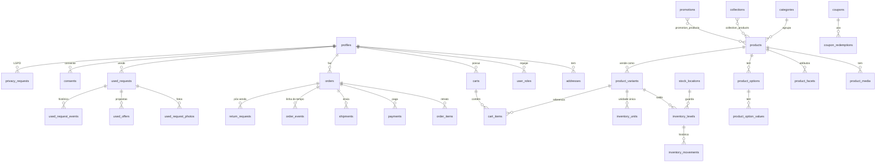

# Mapeamento de telas, produtos e usuários para o banco de dados

**DinoBlack Games e Informática** · Versão 0.1 · 5 de novembro de 2026
Status: pronto para a integração e para testes com dados fictícios. **Nada foi aplicado em nenhum banco remoto.** *(14/11/2026: a loja já lê o catálogo e o checkout grava pedidos nesse banco, local ou via `DATABASE_URL`; as fases do plano de integração estão marcadas na seção 11.)* Tudo foi validado num Postgres local (ver seção 12).

> **Fontes do mapeamento (Fato):** código do storefront (`storefront/src`), protótipo do painel (`admin-preview/admin-map.json`, 10 módulos e 52 páginas), documento de desenvolvimento v1.2 e o plano da página de produto. Onde algo ainda não existe no código, está marcado **a criar**. Decisões que dependem do cliente estão em **Validar**.

Arquivos desta entrega:

| Arquivo | Para que serve |
| --- | --- |
| [`supabase/migrations/`](../supabase/migrations/) | Schema (49 tabelas), funções de estoque e pedido, views e RLS. Pronto para `supabase db reset` ou `psql`. |
| [`supabase/seed.sql`](../supabase/seed.sql) | Dados fictícios: 24 produtos, 10 usuários, 10 pedidos, 5 usados, banners, páginas, cupons. Gerado. |
| [`docs/Dicionario_de_Dados.md`](./Dicionario_de_Dados.md) | Todas as tabelas e colunas, gerado a partir do banco real. |
| [`supabase/tools/`](../supabase/tools/) | Gerador do seed, gerador do dicionário e a suíte de 110 verificações. |

---

## 1. Resumo

| Item | Quantidade |
| --- | --- |
| Telas da loja (existentes) | 4 rotas + 5 blocos globais (header, busca, carrinho, menu da conta, rodapé) |
| Telas da loja (a criar, já linkadas ou previstas) | 16 grupos de rotas (alguns com várias telas) |
| Telas do painel administrativo (protótipo) | 52 páginas em 10 módulos |
| Perfis de usuário | 2 públicos (visitante, cliente) + 6 de equipe |
| Tabelas / views / funções / políticas de RLS | 49 / 4 / 10 / 140 |
| Dados fictícios | 10 usuários, 24 produtos (22 publicados), 10 pedidos em 7 status, 5 usados, 4 cupons, 3 promoções, 6 banners, 9 páginas |
| Verificações automáticas | 110 no banco (migrations, seed, RLS, regras, checkout) + 46 ponta a ponta do checkout, todas passando |

---

## 2. Usuários e permissões

### 2.1 Perfis

| Perfil | Quem é | Como entra | Papel no banco |
| --- | --- | --- | --- |
| Visitante | Navega, busca, vê produtos, envia contato e pedido de usado | Sem login | `anon` |
| Cliente | Compra, acompanha pedidos, edita dados, preferências e privacidade | Cadastro e login (Supabase Auth) | `authenticated` sem papel de equipe |
| Dono (`owner`) | Responsável pela loja: tudo, inclusive papéis, integrações e configurações | Login | `user_roles.role = owner` |
| Gerente (`manager`) | Operação e comercial: catálogo, pedidos, promoções, relatórios | Login | `manager` |
| Estoque (`stock`) | Saldos, unidades únicas, movimentações, separação e envio | Login | `stock` |
| Avaliador (`appraiser`) | Triagem, avaliação e propostas de usados | Login | `appraiser` |
| Atendimento (`support`) | Pedidos, clientes, devoluções, mensagens, consentimentos | Login | `support` |
| Editor (`editor`) | Conteúdo: produtos (textos e mídia), banners, páginas, menus, SEO | Login | `editor` |

Um usuário de equipe pode ter mais de um papel. **Validar** com o cliente: quem ocupa cada papel e se `editor` pode publicar sozinho ou só enviar para revisão (hoje publica).

### 2.2 Matriz de permissões (o que o banco já impõe por RLS)

| Área | Visitante | Cliente | `editor` | `support` | `stock` | `appraiser` | `manager` | `owner` |
| --- | :-: | :-: | :-: | :-: | :-: | :-: | :-: | :-: |
| Catálogo publicado (ler) | ✓ | ✓ | ✓ | ✓ | ✓ | ✓ | ✓ | ✓ |
| Catálogo (criar e editar) | | | ✓ | | | | ✓ | ✓ |
| Rascunhos e arquivados (ler) | | | ✓ | ✓ | ✓ | ✓ | ✓ | ✓ |
| Estoque e custo das unidades | | | | | ✓ | | ✓ | ✓ |
| Laudo da unidade disponível | ✓ | ✓ | ✓ | ✓ | ✓ | ✓ | ✓ | ✓ |
| Meus pedidos, itens, pagamento, envio | | ✓ (só os seus) | | | | | | |
| Todos os pedidos (ler) | | | ✓ | ✓ | ✓ | ✓ | ✓ | ✓ |
| Pedidos (alterar status, notas) | | | | ✓ | | | ✓ | ✓ |
| Envio e rastreio | | | | ✓ | ✓ | | ✓ | ✓ |
| Devoluções | | criar as suas | | ✓ | | | ✓ | ✓ |
| Usados | | criar e ver os seus | | | | ✓ | ✓ | ✓ |
| Promoções e cupons | | | | | | | ✓ | ✓ |
| Banners, páginas, menus, redirects | | | ✓ | | | | ✓ | ✓ |
| Clientes, endereços, consentimentos | | os seus | | ✓ | | | ✓ | ✓ |
| Solicitações de privacidade | | criar as suas | | | | | ✓ | ✓ |
| Auditoria, integrações, configurações | | | | | | | ler | ✓ |
| Papéis da equipe | | | | | | | | ✓ |

Regras que não dependem da tela: o **cliente nunca altera pedido diretamente** (só pelas funções `create_order_from_cart` e `cancel_order`); **só o servidor** (`service_role`) confirma pagamento (`confirm_payment`); **custo e serial** das unidades nunca chegam ao navegador do visitante (a loja lê a view `v_public_units`).

---

## 3. Telas da loja

Legenda de estado: **existe** (já publicada), **a criar** (linkada ou prevista nos documentos).

| Rota | Estado | Quem acessa | Lê | Grava | Notas |
| --- | --- | --- | --- | --- | --- |
| `/` Home | existe | todos | `banners`, `v_product_listing`, `categories`, `promotions`, `collections` | `analytics_events` | Hero, Flash Drop com contagem, categorias, "Produtos em Destaques" e "em Promoção" |
| `/loja` | existe | todos | `v_product_listing`, `categories`, `product_facets` | `analytics_events` | Filtros, ordenação e busca por URL; ver seção 7 |
| `/produto/[slug]` | existe | todos | `products`, `product_media`, `product_options`, `product_variants`, `v_public_units`, `v_product_listing` | `analytics_events`, `back_in_stock_alerts` | Laudo só para seminovo e raridade |
| `/design-system` | existe | interno | nenhum | nenhum | Documentação viva; fora do banco |
| `/carrinho` | existe (redireciona) | todos | nada | nada | Leva ao checkout. O carrinho é a gaveta do header e fica salvo no navegador (localStorage); o banco só vê os itens na cotação e no pedido |
| `/checkout` | **existe** | visitante (compra sem cadastro) | `checkout_quote()` → `products`, `product_variants`, `inventory_*`, `promotions`, `coupons` | `create_checkout_order()` → `orders`, `order_items`, `inventory_*`, `coupon_redemptions`; `consents`; `payments` e `integration_events` via Mercado Pago | Dados, entrega por CEP, cupom, pagamento (Mercado Pago). Ver [Checkout_Mercado_Pago.md](./Checkout_Mercado_Pago.md) |
| `/checkout/confirmacao/[número]` | **existe** | dono do pedido (token no link) | `orders`, `order_items`, `payments`, `shipments` | `sync_mp_payment()` ao conferir o pagamento | Pix com QR e copia e cola, status ao vivo, itens e entrega |
| `/entrar`, `/cadastro`, `/recuperar-senha` | **a criar** | visitante | Supabase Auth | `profiles`, `consents` | Cadastro cria `profiles` por gatilho |
| `/conta` | **a criar** (linkada) | cliente | `profiles`, `addresses`, `consents` | `profiles`, `addresses`, `consents` | Dados, endereços, preferências |
| `/conta/privacidade` | **a criar** | cliente | `privacy_requests` | `privacy_requests` | Acesso, correção, exclusão |
| `/pedidos` | **a criar** (linkada) | cliente | `orders`, `order_items`, `payments`, `shipments` | `cancel_order()` (só pendente) | Lista e filtros por status |
| `/pedidos/[número]` | **a criar** | cliente | itens com retrato, `order_events`, `shipments.events` | `return_requests` | Linha do tempo e rastreio |
| `/venda-seu-usado` (Projeto Drop) | **a criar** (hoje WhatsApp) | todos | `pages`, `categories` | `used_requests`, `used_request_photos`, `consents` | Formulário com fotos e aceite dos termos |
| `/venda-seu-usado/[protocolo]` | **a criar** | cliente | `used_requests`, `used_offers`, `used_request_events` | `used_offers.decision` (aceitar ou recusar) | Acompanhamento do status |
| `/sobre`, `/contato` | **a criar** (linkadas) | todos | `pages`, `store_settings` | `contact_messages` (contato) | |
| `/pagina/[slug]` (quem somos, trabalhe conosco, entrega e garantia, troca, privacidade, regulamento, Projeto Drop) | **a criar** | todos | `pages` (publicadas) | nada | `kind`: institutional, policy, campaign |
| `/avise-me` (ação na página de produto) | **a criar** | todos | `back_in_stock_alerts` | `back_in_stock_alerts`, `consents` | Só com consentimento do canal |
| `404`, erro, manutenção | **a criar** | todos | `redirects` (middleware) | nada | Redirects 301 do site antigo |
| `/comparar`, `/lista-de-desejos`, `/kits/[slug]` | evolução posterior | | `kits`, `kit_components` | | Kits modelados; lista de desejos **não** modelada |

### 3.1 Blocos globais (aparecem em todas as telas)

| Bloco | Dados de hoje (código) | Fonte no banco |
| --- | --- | --- |
| Barra superior | Telefone/WhatsApp, YouTube, TikTok, Facebook, "Venda seu usado" | `store_settings` (`contact`, `socials`), link de WhatsApp montado no servidor |
| Logo e busca | Busca por texto, "buscas em alta", "categorias populares" | `categories`; buscas em alta = agregado de `analytics_events` (ou lista editável) |
| Tema | Escuro/claro (preferência local) | Só navegador; opcional em `profiles` (**Validar**) |
| Menu da conta | Nome "Cliente DinoBlack", telefone, links Conta/Pedidos/Sair | `profiles` do usuário logado |
| Carrinho (gaveta) | Linhas com produto, cor, armazenamento, quantidade, subtotal | `cart_items` + `product_variants` (linha = variação + unidade) |
| Navegação por categorias | 4 categorias, links Início/Loja/Sobre/Contato | `nav_items` (`header`, `categories`) e `categories` |
| Rodapé | Marca, texto, endereço (Maps), redes, 4 colunas de links | `store_settings`, `nav_items` (`footer`); hoje as colunas são texto sem link |

---

## 4. Telas do painel administrativo

Gerado a partir de `admin-map.json`: as 52 páginas dos 10 módulos, com perfis, leitura e escrita no banco. A coluna **Fase** repete a do protótipo.


### Painel  _(módulo do protótipo: MVP)_

| Página | Fase | Perfis | Lê | Grava |
| --- | --- | --- | --- | --- |
| **Visão geral** (`dashboard`) | MVP | owner, manager, editor, support, stock, appraiser | orders, order_items, inventory_levels, v_inventory_alerts, used_requests, v_sales_daily | nada |
| **Mapa de navegação** (`mapa`) | MVP | owner, manager, editor, support, stock, appraiser | nada (índice estático) | nada |

### Vendas e clientes  _(módulo do protótipo: MVP)_

| Página | Fase | Perfis | Lê | Grava |
| --- | --- | --- | --- | --- |
| **Pedidos** (`orders`) | MVP | owner, manager, support, stock | orders, order_items, profiles, payments, shipments | orders (status, notas), order_events |
| **Pedidos recentes** (`orders-new`) | MVP | owner, manager, support, stock | orders, order_events | nada |
| **Aguardando pagamento** (`orders-payment`) | MVP | owner, manager, support | orders, payments, integration_events | payments (conciliação), order_events |
| **Preparação e envio** (`orders-fulfillment`) | MVP | owner, manager, stock | orders, order_items, shipments, inventory_units | shipments, order_events, inventory_movements |
| **Cancelamentos e devoluções** (`orders-returns`) | MVP | owner, manager, support | return_requests, orders, order_items | return_requests, payments (estorno), inventory_movements, order_events |
| **Clientes** (`customers`) | MVP | owner, manager, support | profiles, addresses, orders | profiles, addresses |
| **Consentimentos e preferências** (`customer-consent`) | MVP | owner, manager, support | consents | consents |
| **Solicitações de privacidade** (`customer-requests`) | MVP | owner, manager | privacy_requests, profiles | privacy_requests, audit_log |

### Catálogo  _(módulo do protótipo: MVP)_

| Página | Fase | Perfis | Lê | Grava |
| --- | --- | --- | --- | --- |
| **Produtos** (`products`) | MVP | owner, manager, editor | products, product_variants, product_media, inventory_levels, v_product_listing | products (status, preço) |
| **Cadastrar produto** (`product-new`) | MVP | owner, manager, editor | categories, product_options | products, product_variants, product_media, product_facets, product_options, product_option_values, inventory_units |
| **Categorias** (`categories`) | MVP | owner, manager, editor | categories | categories |
| **Coleções e destaques** (`collections`) | MVP | owner, manager, editor | collections, collection_products | collections, collection_products |
| **Kits e compatibilidade** (`kits`) | Evolução posterior | owner, manager | kits, kit_components, products | kits, kit_components |
| **Atributos e condições** (`product-attributes`) | MVP | owner, manager, editor | product_facets, inventory_units | product_facets, inventory_units (laudo, grau) |

### Estoque  _(módulo do protótipo: MVP)_

| Página | Fase | Perfis | Lê | Grava |
| --- | --- | --- | --- | --- |
| **Visão do estoque** (`inventory`) | MVP | owner, manager, stock | inventory_levels, inventory_units, product_variants | nada |
| **Movimentações** (`inventory-movements`) | MVP | owner, manager, stock | inventory_movements | nada |
| **Ajustes e contagem** (`inventory-adjustments`) | MVP | owner, manager, stock | inventory_levels | inventory_levels, inventory_movements, audit_log |
| **Alertas de estoque** (`inventory-alerts`) | MVP | owner, manager, stock | v_inventory_alerts, admin_notifications | admin_notifications |
| **Locais de estoque** (`inventory-locations`) | Validar na descoberta | owner, manager, stock | stock_locations | stock_locations |

### Avaliação de usados  _(módulo do protótipo: Evolução posterior)_

| Página | Fase | Perfis | Lê | Grava |
| --- | --- | --- | --- | --- |
| **Solicitações recebidas** (`used-intake`) | MVP | owner, manager, appraiser | used_requests, used_request_photos | used_requests (triagem, responsável) |
| **Avaliação do item** (`used-review`) | MVP | owner, manager, appraiser | used_requests, used_request_photos, used_request_events | used_requests (status), used_request_events |
| **Propostas e decisões** (`used-offers`) | MVP | owner, manager, appraiser | used_offers, used_requests | used_offers, used_request_events, inventory_units (ao entrar no estoque) |

### Loja e conteúdo  _(módulo do protótipo: MVP)_

| Página | Fase | Perfis | Lê | Grava |
| --- | --- | --- | --- | --- |
| **Editor visual** (`store-editor`) | MVP | owner, manager, editor | pages, banners, nav_items | pages, banners, nav_items (rascunho e publicação) |
| **Banners e campanhas** (`store-banners`) | MVP | owner, manager, editor | banners | banners |
| **Páginas institucionais** (`store-pages`) | MVP | owner, manager, editor | pages | pages |
| **Menus e navegação** (`store-navigation`) | MVP | owner, manager, editor | nav_items | nav_items |
| **SEO e metadados** (`store-seo`) | MVP | owner, manager, editor | products, categories, pages | products, categories, pages (campos seo_*) |
| **URLs e redirecionamentos** (`store-redirects`) | MVP | owner, manager, editor | redirects | redirects |

### Promoções e automações  _(módulo do protótipo: MVP + evolução)_

| Página | Fase | Perfis | Lê | Grava |
| --- | --- | --- | --- | --- |
| **Promoções** (`promotions`) | MVP | owner, manager | promotions, promotion_products, collections | promotions, promotion_products |
| **Cupons** (`coupons`) | MVP | owner, manager | coupons, coupon_redemptions | coupons |
| **Automações de relacionamento** (`marketing-flows`) | Evolução posterior | owner, manager | nada (tabela futura) | nada (tabela futura) |
| **Públicos e consentimentos** (`campaign-audience`) | Validar na descoberta | owner, manager | consents, profiles | nada |

### Relatórios  _(módulo do protótipo: MVP base + evolução)_

| Página | Fase | Perfis | Lê | Grava |
| --- | --- | --- | --- | --- |
| **Resumo operacional** (`reports`) | MVP | owner, manager | v_sales_daily, orders, v_inventory_alerts | nada |
| **Vendas** (`reports-sales`) | MVP | owner, manager | orders, v_sales_daily | nada |
| **Produtos e categorias** (`reports-products`) | MVP | owner, manager | order_items, products, v_product_listing | nada |
| **Saúde do estoque** (`reports-inventory`) | MVP | owner, manager, stock | inventory_movements, v_inventory_alerts | nada |
| **Conversão e checkout** (`reports-funnel`) | Evolução posterior | owner, manager | analytics_events | nada |

### Integrações  _(módulo do protótipo: Validar na descoberta)_

| Página | Fase | Perfis | Lê | Grava |
| --- | --- | --- | --- | --- |
| **Visão das integrações** (`integrations`) | MVP | owner, manager | integrations, integration_events | integrations |
| **Pagamentos** (`integration-payments`) | MVP | owner, manager | integrations, payments, integration_events | integrations |
| **Frete e rastreio** (`integration-shipping`) | MVP | owner, manager | integrations, shipments | integrations |
| **ERP e estoque** (`integration-erp`) | MVP | owner, manager | integrations, integration_events | integrations |
| **Emissão fiscal** (`integration-fiscal`) | MVP | owner, manager | integrations (sem tabela fiscal ainda) | integrations |
| **E-mail e WhatsApp** (`integration-messaging`) | MVP | owner, manager | integrations, consents | integrations |
| **Analytics e anúncios** (`integration-analytics`) | MVP | owner, manager | integrations, analytics_events | integrations |

### Configurações  _(módulo do protótipo: Validar na descoberta)_

| Página | Fase | Perfis | Lê | Grava |
| --- | --- | --- | --- | --- |
| **Dados da loja** (`settings-store`) | MVP | owner | store_settings | store_settings |
| **Equipe e permissões** (`settings-team`) | MVP | owner | profiles, user_roles | user_roles, profiles |
| **Notificações administrativas** (`settings-notifications`) | MVP | owner, manager | admin_notifications, store_settings | store_settings |
| **Políticas comerciais** (`settings-policies`) | MVP | owner, manager | pages (kind = policy) | pages (kind = policy) |
| **Histórico de alterações** (`settings-audit`) | MVP | owner, manager | audit_log | nada |
| **Segurança e privacidade** (`settings-security`) | MVP | owner | privacy_requests, store_settings | store_settings |

Telas que **ainda não têm tabela** (marcadas acima): fluxos de marketing (`marketing-flows`) e emissão fiscal (`integration-fiscal`, hoje só `integrations` e `integration_events`). Ficam para depois da escolha de fornecedor.

---

## 5. Produtos: do código atual para o banco

### 5.1 Campo a campo

| Hoje no código (`storefront/src`) | No banco | Observação |
| --- | --- | --- |
| `Product.id`, `slug`, `name` | `products.id`, `slug`, `name` | `slug` é a URL e precisa ser estável |
| `Product.price` | `product_variants.price` | Menor preço efetivo, via `effective_price()` (aplica promoção vigente) |
| `Product.compareAt` | `product_variants.compare_at` | Preço "de" |
| `Product.discount` | derivado: `v_product_listing.discount_percent` | Não se grava; calcula-se de `compare_at` e promoções |
| `Product.badge` | `products.badge` | Ex.: Flagship, Premium Gear |
| `Product.image` | `product_media` (menor `position`) | Fotos hospedadas em armazenamento próprio (hoje Unsplash) |
| `Product.category` (nome) | `products.category_id` → `categories` | Slug: consoles, pc-gamer, retro, notebooks |
| `Product.rating`, `sold` | `products.rating`, `sold_count` | `sold_count` sobe em `confirm_payment()`; avaliação só com fonte confiável |
| `Product.stockLeft` | derivado: `v_product_listing.available` | Saldo menos reservas, mais unidades únicas disponíveis |
| `ProductDetail.sku`, `brand` | `products.sku`, `products.brand` | `variants.sku` por cor/armazenamento |
| `ProductDetail.condition` | `products.condition` | novo, seminovo, raridade, pre_venda |
| `ProductDetail.platform`, listagem `type` | `product_facets` (`platform`, `type`) | Mais: `brand`, `storage`, `cpu`, `gpu`, `ram` |
| `ProductDetail.tagline` | `products.tagline` | |
| `ProductDetail.gallery` | `product_media` (`url`, `alt`, `position`, `crop`) | |
| `ProductDetail.options` (cor, armazenamento) | `product_options`, `product_option_values`, `product_variants.option_values` | Esgotada = variação sem saldo |
| `ProductDetail.highlights/specs/inBox/faq` | `products.highlights/specs/in_box/faq` (jsonb) | Editados como bloco no admin, mesmo formato do código |
| `ProductDetail.warranty` | `products.warranty_months`, `warranty_text` | Seminovo: `inventory_units.warranty_days` |
| `ProductDetail.unit` (laudo) | `inventory_units` via `v_public_units` | Grau, testes, marcas, itens, fotos reais da unidade |
| `CartLine` (produto, qtd, cor, armazenamento) | `cart_items` (`variant_id`, `unit_id`, `quantity`) | O defeito atual do carrinho (mesma linha para cores diferentes) some: a linha é variação + unidade |
| `HERO_SLIDES` | `banners` (`home_hero`) | |
| Flash Drop (contagem regressiva) | `promotions` com `show_countdown` | O fim da promoção alimenta o relógio |
| `CATEGORIES`, `NAV_LINKS`, rodapé | `categories`, `nav_items` | |

### 5.2 Produtos fictícios do seed (24)

| Categoria | Produtos | Condições |
| --- | --- | --- |
| Consoles (8) | PlayStation 5 Slim 1 TB, Nintendo Switch OLED, DualSense branco, Xbox Series S, Switch Lite, PlayStation 4 Pro, Controle Pro Switch, PlayStation 5 Pro (pré-venda) | novo, seminovo (2 unidades únicas), pré-venda |
| PC Gamer (7 + 1 rascunho) | PC Ryzen 7 RTX 4070, Headset 7.1, Teclado mecânico, Mouse, Monitor 27" 165 Hz, SSD NVMe 1 TB, RTX 4060 8 GB, Fone sem fio (rascunho) | novo |
| Retro (4 + 1 arquivado) | Console Retrô Mini, Mega Drive, Super Nintendo, Cartucho Super Mario World, Console antigo (arquivado) | novo, raridade (2), seminovo |
| Notebooks (3) | Gamer RTX 4060, Core i5 15", Core i7 seminovo | novo, seminovo (unidade única) |

Os 8 primeiros (os da loja de demonstração) mantêm **os mesmos preços, descontos e saldos** da loja; a suíte confere isso (por exemplo, PS5 R$ 3.899 de R$ 4.299, desconto de 9% e 3 disponíveis).

---

## 6. Filtros e listagem: da URL para a consulta

A página `/loja` hoje filtra em memória (`lib/shop.ts`). Com o banco, cada filtro vira uma condição sobre `v_product_listing`:

| Parâmetro da URL | Condição no banco |
| --- | --- |
| `categoria=consoles` | `category_slug = 'consoles'` |
| `condicao=seminovo,raridade` | `condition in (...)` |
| `plataforma=playstation` | `facets -> 'platform' ? 'PlayStation'` (ou join em `product_facets`) |
| `tipo=periferico` | `facets -> 'type' ? 'Periférico'` |
| `preco=500-2000` | `current_price >= 500 and current_price < 2000` |
| `promocao=1` | `discount_percent is not null` |
| `q=headset` | `name ilike '%headset%'` hoje; `pg_trgm` ou busca de texto completo depois |
| `ordem=menor-preco` | `order by current_price` (maior preço, `discount_percent desc`, `sold_count desc`) |

**Contagens por opção** (disjuntivas) continuam calculadas na aplicação sobre o mesmo conjunto, ou por uma função SQL se o catálogo crescer. Com 248 produtos (a amostra do painel) a consulta única com `facets` jsonb é suficiente.

---

## 7. Jornadas e o que cada passo toca

| Jornada | Passos | Tabelas e funções |
| --- | --- | --- |
| **Descobrir e comprar (novo)** | Home, loja com filtros, produto, CEP, carrinho, checkout, pagamento, confirmação | `v_product_listing` → `products`/`product_variants` → `cart_items` → `create_order_from_cart()` (reserva, preço do servidor, cupom) → `confirm_payment()` (baixa estoque, cria envio) |
| **Comprar seminovo de unidade única** | Produto com laudo, carrinho com a unidade, reserva exclusiva, pagamento | `v_public_units` → `cart_items.unit_id` → `inventory_units.status`: disponível, reservado, vendido |
| **Pagamento não chega** | Pix expira, estoque volta | `expire_pending_orders()` → `cancel_order()` → `_release_order_stock()` |
| **Pós-venda** | Rastreio, devolução ou garantia | `shipments.events`, `return_requests`, `order_events` |
| **Vender um usado** | Formulário, fotos, protocolo, avaliação, proposta, decisão | `used_requests` (protocolo `US-NNNN`), `used_request_photos`, `used_offers`, `used_request_events` |
| **Aviso de reposição** | Avise-me, estoque chega | `back_in_stock_alerts` (+ `consents` do canal) |
| **Privacidade (LGPD)** | Pedir acesso, correção ou exclusão | `privacy_requests`, `consents`, `audit_log` |
| **Operar o painel** | Editar produto, ajustar estoque, tratar pedido, publicar banner | Tabelas do módulo + `audit_log` + `admin_notifications` |

---

## 8. Modelo de dados



Detalhe de todas as colunas: [Dicionario_de_Dados.md](./Dicionario_de_Dados.md). Decisões de modelagem que importam:

- **Preço e promoção separados.** `compare_at` é o "de" de vitrine; `promotions` são campanhas com vigência. O preço cobrado é sempre `effective_price()`, calculado no servidor.
- **Unidade única é uma tabela própria** (`inventory_units`), não uma quantidade 1. Cada unidade tem laudo, fotos, garantia e custo, e um estado (disponível, reservado, vendido, baixa).
- **O pedido guarda o retrato** (`order_items.snapshot`): nome, SKU, condição, opções, imagem, garantia e laudo na hora da compra. Mudar o catálogo depois não reescreve o histórico.
- **Blocos editoriais em `jsonb`** (destaques, especificações, caixa, FAQ), porque o admin os edita como um todo e o código já os usa nesse formato.
- **Atributos filtráveis em `product_facets`**, para a loja filtrar sem alterar o schema a cada atributo novo.
- **E-mails, telefones e CPF:** o banco guarda só os três últimos dígitos do documento (`document_hint`). **Validar** a política de dados pessoais antes de guardar mais que isso.

---

## 9. Regras de negócio que o banco já garante

| Regra | Onde | Testado |
| --- | --- | :-: |
| Preço cobrado vem do servidor, nunca do navegador | `create_order_from_cart` + `effective_price` | ✓ |
| Reserva de estoque no pedido; baixa só no pagamento | `create_order_from_cart`, `confirm_payment` | ✓ |
| Unidade única nunca é vendida duas vezes | `FOR UPDATE` + status `reservado` | ✓ |
| Webhook de pagamento repetido não duplica efeito | `confirm_payment` idempotente | ✓ |
| Cancelamento devolve estoque e expira o pagamento | `cancel_order`, `_release_order_stock` | ✓ |
| Pedido Pix vencido é cancelado | `expire_pending_orders` | ✓ |
| Cupom: vigência, mínimo, limite total e por cliente | `create_order_from_cart` | ✓ |
| Total do pedido = subtotal − desconto + frete | `check` em `orders` | ✓ |
| Saldo em mãos nunca fica negativo nem abaixo do reservado | `check` em `inventory_levels` | ✓ |
| Cliente só enxerga o que é dele; custo de unidade nunca vai ao visitante | RLS e `v_public_units` | ✓ |

---

## 10. Dados fictícios de teste

### 10.1 Usuários (senha padrão `Teste@2026`, **somente no banco local**)

| E-mail | Papel |
| --- | --- |
| `owner@teste.dinoblack.example` | dono |
| `gerente@teste.dinoblack.example` | gerente |
| `estoque@teste.dinoblack.example` | estoque |
| `avaliador@teste.dinoblack.example` | avaliador de usados |
| `atendimento@teste.dinoblack.example` | atendimento |
| `editor@teste.dinoblack.example` | editor de conteúdo |
| `ana@…`, `bruno@…`, `carla@…`, `diego@…` | clientes (cada um com pedidos, endereços e carrinho próprios) |

Todos os nomes têm "(teste)", os e-mails usam o domínio reservado `.example` (nunca recebem mensagem) e os telefones são `(61) 90000-00xx`. Nenhum dado pessoal real.

### 10.2 Cenários cobertos

| Cenário de teste | Onde está nos dados |
| --- | --- |
| Produto com desconto de vitrine | PS5, Switch, notebook, retrô, headset, teclado (mesmos % da loja) |
| Promoção vigente com contagem | "Flash Drop de novembro" (mouse, monitor, SSD), termina em 6 h |
| Promoção em rascunho e promoção encerrada | "Oferta Retro (rascunho)", "Semana Gamer (encerrada)" |
| Variação esgotada | PS5 Preto (saldo 0); aviso de reposição de dois clientes |
| Estoque abaixo do mínimo | PS5 Branco (3 disponíveis, mínimo 5) |
| Seminovo de unidade única | DualSense, PS4 Pro, notebook i7, SNES (vendida), com laudo e fotos |
| Raridade | Mega Drive, cartucho Super Mario World |
| Pré-venda | PS5 Pro 2 TB |
| Rascunho e arquivado (invisíveis ao público) | Fone sem fio, console antigo |
| Pedido em cada status | DB-1001 entregue, 1002 enviado, 1003 preparo, 1004 e 1010 pagos, 1005 aguardando Pix, 1006 cancelado, 1007 pago (visitante, unidade única), 1008 devolvido |
| Cupom percentual, valor fixo, expirado, esgotado | DINO10, BEMVINDO50, EXPIRADO, LIMITE1 |
| Pagamento: Pix, cartão parcelado | Pedidos variados, parcelas de 1 a 4 |
| Compra de visitante sem cadastro | DB-1007 (`guest_email`) |
| Devolução por garantia | DB-1008 e a solicitação associada |
| Venda de usado em todas as etapas | US-0080 aceita, 0081 recusada, 0082 em avaliação, 0083 aguardando cliente, 0084 nova |
| Carrinho aberto, com unidade única | Ana (Switch Neon e SSD), Diego (DualSense) |
| Consentimento concedido e revogado | Clientes com Pix/WhatsApp e e-mail de marketing |
| Privacidade | Pedido de acesso (em andamento) e de exclusão (recebido) |
| Páginas, banners e menus em vários estados | Publicado, rascunho, encerrado, sem link |

### 10.3 Como carregar e testar

```bash
cd supabase/tools
npm install
npm run validate     # aplica migrations + seed num Postgres local (PGlite) e roda as 110 verificações
npm run seed:build   # regenera supabase/seed.sql
npm run docs         # regenera docs/Dicionario_de_Dados.md
```

Num projeto Supabase de **desenvolvimento ou teste** (nunca produção): `supabase init` e `supabase db reset`, que aplica as migrations e o `seed.sql`. O seed cria usuários em `auth.users` e as identidades de e-mail, então o login funciona. **Atenção:** a senha padrão está neste repositório público. Num banco acessível pela internet, gere antes um seed com senha própria (`SEED_PASSWORD="..." npm run seed:build`, que grava `supabase/seed.local.sql`, ignorado pelo Git); do contrário qualquer pessoa entraria como dono da loja de teste.

---

## 11. Plano de integração

| Fase | O que entrega | Pré-requisito |
| --- | --- | --- |
| **0. Ambiente** | Projeto Supabase de desenvolvimento, migrations e seed aplicados, variáveis de ambiente | **Escolher o projeto** e liberar o alvo no Access Hub |
| **1. Leitura do catálogo** *(feito em 14/11/2026: `lib/server/catalog.ts`)* | Camada de dados (`lib/db`) com a interface `getProduct`, `listProducts`, `getUnit`; `/loja`, `/produto` e home lendo do banco; troca de `data/demo.ts` e `catalog.ts` por consultas | Fase 0 |
| **2. Contas** | Cadastro, login, recuperação, `/conta`, endereços, preferências | Fase 1; provedores de login (e-mail e Google) |
| **3. Carrinho e pedido** *(checkout de visitante feito; falta conta e `/pedidos`)* | Carrinho persistido, checkout chamando `create_order_from_cart`, pagamento de teste chamando `confirm_payment`, `/pedidos` | Fase 2 |
| **4. Painel real** | Telas do admin por módulo, com os papéis da seção 2; começar por Pedidos, Catálogo e Estoque | Fase 3 |
| **5. Usados e conteúdo** | Formulário do Projeto Drop com fotos em bucket privado, páginas institucionais, banners editáveis | Fase 2 |
| **6. Integrações reais** | Gateway, frete, ERP, fiscal, mensagens, analytics | Escolha de fornecedores |

**Decisões pendentes (Validar):**

1. Qual projeto Supabase usar para desenvolvimento e teste, e quem controla a conta do cliente?
2. Login: só e-mail e senha, ou também Google (a conta do cliente já usa)?
3. Compra sem cadastro (visitante) entra no MVP? O modelo já aceita (`guest_email`).
4. Escala de condição do seminovo (hoje texto livre: "Muito bom", "Bom") e quem a define.
5. Política de garantia, troca e devolução (os prazos do seed são ilustrativos).
6. Parcelamento (o seed usa até 10x sem juros) e eventual desconto à vista.
7. Retirada na loja (Santa Maria) como opção de frete, com prazo.
8. Fonte canônica de estoque: banco da loja ou ERP? Muda quem escreve em `inventory_levels`.
9. Retenção de dados e política de privacidade antes de guardar documentos e fotos de usados.

---

## 12. Como isto foi validado

Tudo roda num Postgres local em memória (PGlite), com um stub do Supabase Auth, **sem tocar em nenhum banco remoto**:

- **As 3 migrations** e o **seed** executam sem erro (todas as restrições são respeitadas, inclusive total do pedido, saldo e reservas).
- **Integridade:** subtotal = soma dos itens; saldo de cada variação = soma das movimentações; reservas = itens de pedidos aguardando pagamento; unidade vendida pertence a pedido pago.
- **Paridade com a loja:** descontos, preços e saldos dos 8 produtos originais iguais aos da loja de demonstração.
- **RLS:** 25 cenários como visitante, cliente e cada papel de equipe.
- **Regras:** reserva, confirmação idempotente, conflito de unidade única, estoque insuficiente, cupons, cancelamento, expiração de Pix e relatórios.

A suíte encontrou e corrigiu um erro real na função de criar pedido (violava a regra do total ao inserir). O que **não** foi testado: concorrência real entre duas transações simultâneas (PGlite é de uma conexão só; a proteção existe via `FOR UPDATE`, mas deve ser exercitada num Postgres de verdade), o login real do Supabase Auth e o desempenho com volume grande.

---

## 13. Lacunas conhecidas

- **Não modelado ainda:** lista de desejos, comparador, fluxos de marketing (recuperação de carrinho), emissão fiscal (só o inventário da integração), regras de compatibilidade de kits além de `kit_components`.
- **Armazenamento de arquivos:** buckets para fotos de produto e fotos de usados (privado, com expiração) precisam ser criados no Supabase; o banco guarda só o caminho.
- **Busca:** hoje `ilike`; para relevância e tolerância a erro, habilitar `pg_trgm` ou busca de texto completo.
- **Fotos de demonstração:** vêm do Unsplash e **algumas não combinam com o produto** (o Switch OLED mostra um Xbox, o DualSense mostra um controle de PS4). Substituir antes de divulgar.
- **Limite de abuso:** inserções anônimas (contato, eventos, avise-me) precisam de limitação de taxa na camada de API.
